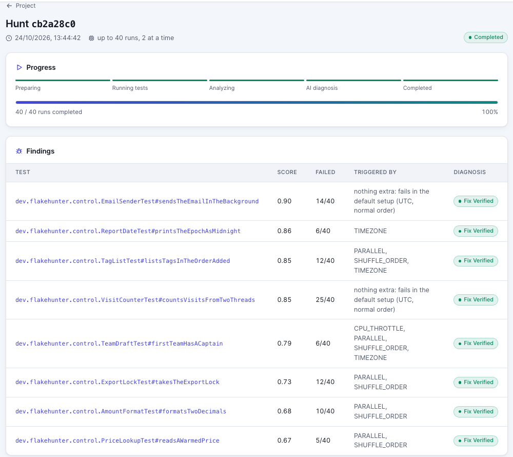
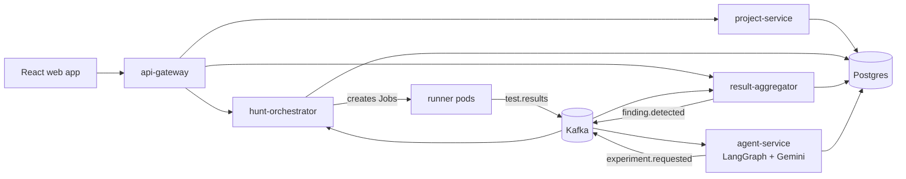
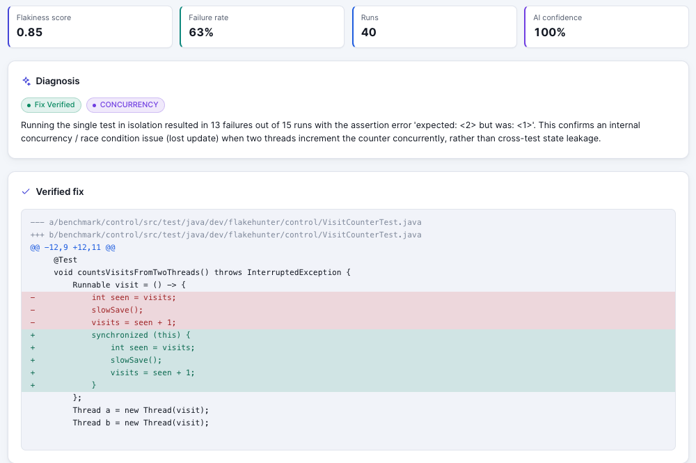

# FlakeHunter

[](https://github.com/varunofficial2509/FlakeHunter/actions/workflows/ci.yml)
[](LICENSE)

**Finds flaky tests in a Java repository, then AI agents prove why they flake and write a fix that is verified by rerunning it.**

A flaky test passes and fails on the same code. Teams usually notice by accident, rerun CI until it is green, and never learn the cause. FlakeHunter takes a repository and a commit, reruns the test suite many times in parallel Kubernetes pods while shaking the environment (test order, time zone, parallelism, CPU), and reports which tests flip. AI agents then investigate each one: they run their own experiments, name the root cause, write a patch, and the patch only counts once the test passes on every rerun.



## How it works

1. **Hunt.** You give a repository and a commit SHA. The orchestrator clones and compiles it once, then starts runner pods as Kubernetes Jobs. Each run uses a strategy such as `BASELINE`, `SHUFFLE_ORDER`, `RANDOM_SEED`, `TIMEZONE`, `PARALLEL` or `CPU_THROTTLE`.
2. **Analyze.** Runners stream JUnit results through Kafka. The aggregator scores every test and flags those with both passes and failures, along with the strategies that trigger them.
3. **Diagnose.** One agent session per flaky test (Python, LangGraph): triage, an investigator that orders targeted experiments (for example "run this test alone 30 times"), a classifier, a fix writer, and a critic that reviews the patch.
4. **Verify.** The patched test is rerun 100 times under the condition that made it fail. Only a fix with zero failures is marked **Fix Verified**.

Detection works with the AI switched off. The agents are an extra layer that can be switched off at runtime; findings wait in Kafka until they come back.





## Results

The `benchmark/control` project seeds one flaky test per root cause (order dependency, shared state, time zone, concurrency, async wait, randomness, unordered collection, resource leak) next to stable tests that must never be reported. One 40-run hunt on 2026-10-24:

| Detected | False positives | Root cause right | Fixes verified | Detection time | Tokens per finding |
| -------- | --------------- | ---------------- | -------------- | -------------- | ------------------ |
| 8/8      | 0               | 7/8              | 8/8            | 186 s          | ~20k               |

The miss: the agents called the unordered-collection test shared state, though their fix still passed 100 reruns. Per-test details are in [`benchmark/results.md`](benchmark/results.md).

Before the platform existed, a plain script reproduced two real flaky tests from [IDoFT](https://github.com/winglam/idoft-637) in alibaba/fastjson ([`benchmark/targets.md`](benchmark/targets.md)). `benchmark/run.py` repeats these hunts through the API and scores them against [`benchmark/expected.json`](benchmark/expected.json).

## Quick start

You need Docker, JDK 21, [k3d](https://k3d.io), Helm and kubectl.

```bash
git clone https://github.com/varunofficial2509/FlakeHunter.git && cd FlakeHunter
FLAKEHUNTER_ADMIN_PASSWORD=pick-one GEMINI_API_KEY=your-key deploy/k3d/up.sh
```

Open http://localhost:8090, log in as `admin`, add a project and start a hunt. To try the control project, use the repository URL `https://github.com/varunofficial2509/FlakeHunter`, test command `-f benchmark/control/pom.xml`, JDK 21, and commit `cb2a28c0766a3a3947b74d6ef5264971856360fa`.

Without `GEMINI_API_KEY` everything runs, but a fake LLM stands in for the agents. The first run builds every image and takes a while. It was built and tested on a 16 GB laptop. See [docs/running-locally.md](docs/running-locally.md) for Grafana, tracing, Docker Compose, tests and everyday commands.

## Tech stack

| Area          | Choice                                                                    |
| ------------- | ------------------------------------------------------------------------- |
| Services      | Java 21, Spring Boot 4, Spring Cloud Gateway, fabric8 Kubernetes client   |
| Agents        | Python 3.12, FastAPI, LangGraph, Gemini                                   |
| Messaging     | Apache Kafka (KRaft), transactional outbox                                |
| Storage       | PostgreSQL 16, one schema per service                                     |
| Web           | React, TypeScript, Vite, TanStack Query                                   |
| Platform      | Kubernetes (k3d), Helm, KEDA (scaling on Kafka lag, agents scale to zero) |
| Observability | OpenTelemetry, Tempo, Prometheus, Grafana                                 |
| CI            | GitHub Actions, Testcontainers, multi-arch images on GHCR                 |

## Repository layout

```
services/      api-gateway, project-service, hunt-orchestrator, result-aggregator (Java), agent-service (Python)
runner/        runner images per JDK and the publisher that streams JUnit results to Kafka
libs/events/   event types shared by the Java services
web/           React app
deploy/        Helm chart, k3d cluster, Docker Compose, size presets
benchmark/     control project, ground truth and the benchmark script
docs/          technical documentation, architecture decisions (adr/), local setup
```

## Documentation

- [Technical documentation](docs/technical-documentation.md): domain model, services, Kafka events, data model, agent design, detection statistics
- [Architecture decision records](docs/adr/): why each major choice was made
- [Running locally](docs/running-locally.md)

## Limits

- Java only: Maven with JUnit 4 or 5.
- Flakiness rarer than about 1 in 40 runs can be missed within a hunt's budget.
- Tests that depend on HashMap or reflection order need a NonDex strategy, which is not built.
- No cloud deployment yet, and no GitHub App: hunts are started from the web app.

## License

[MIT](LICENSE)
